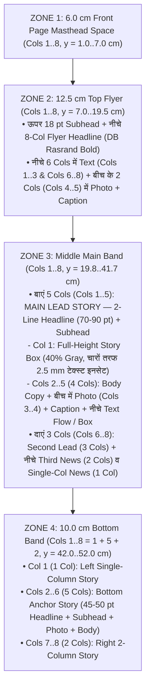

# आदित्य भारत (ADITYA BHARAT) — 8-Page Master Stylesheet & Design Memory Vault
**संस्करण (Edition):** आदित्य भारत (हिंदी दैनिक — 8 Pages Broadsheet)  
**Primary Vault Location:** `E:\RND\ADB HINDI EDITION\ADITYA_BHARAT_DESIGN_VAULT\ADITYA_BHARAT_STYLESHEET_VAULT.md`  
**Machine System Config:** `E:\RND\ADB HINDI EDITION\ADITYA_BHARAT_DESIGN_VAULT\aditya_bharat_stylesheet_system.json`  
**Page 1 Live Builder:** `E:\RND\ADB HINDI EDITION\ADITYA_BHARAT_DESIGN_VAULT\build_aditya_bharat_page1.py`  
**Global Mirror:** `E:\RND\NEWSPAPER_DESIGN_MEMORY_VAULT\ADITYA_BHARAT_8PAGE_STYLESHEET_VAULT.md`

---

## 0. पेज आकार, प्रिंट एरिया और 8-कॉलम ग्रिड (Page Size, Fixed Print Area & 8-Column Grid)

| पैरामीटर (Parameter) | सटीक मान (Specification) | पॉइंट्स में मान (Points @ 72 DPI) | अनिवार्य नियम (Mandatory Rule) |
| :--- | :--- | :--- | :--- |
| **प्रिंट एरिया (Fixed Print Area)** | **`32.0 cm` (चौड़ाई) × `51.0 cm` (ऊंचाई)** | `907.09 pt × 1445.67 pt` | **100% FIXED:** प्रिंट एरिया कभी कम नहीं होगा (`x = 1..33 cm`, `y = 1..52 cm`)। |
| **बाहरी मार्जिन (Outer Margins)** | **`1.0 cm` चारों तरफ** (Top, Bottom, Left, Right) | `28.35 pt` (चारों तरफ) | प्रिंट एरिया के बाहर `1-1-1-1 cm` मार्जिन रहेगा जिससे पेज खुला और सुंदर दिखेगा। |
| **कुल बाहरी पेज साइज (Total Page Canvas)** | **`34.0 cm × 53.0 cm`** | `963.78 pt × 1502.36 pt` | `32 + 2 = 34 cm` चौड़ाई और `51 + 2 = 53 cm` ऊंचाई। |
| **कॉलम संख्या (Columns)** | **8 Columns** (`32.0 cm` प्रिंट एरिया में) | प्रत्येक कॉलम = `3.625 cm` (`102.76 pt`) | सभी खबरें, बॉक्स और फोटो 8-कॉलम ग्रिड पर लॉक रहेंगे। |
| **कॉलम गटर (Gutter Space)** | **`4.0 mm`** (`0.40 cm`) | `11.34 pt` | प्रत्येक दो कॉलम के बीच `4 mm` का साफ गटर स्पेस। |
| **बेसलाइन ग्रिड (Baseline Grid)** | **`11.25 pt`** | Start = `28.35 pt` (`1.0 cm`) | बॉडी टेक्स्ट (`11 pt / 11.25 pt`) सख्ती से बेसलाइन ग्रिड पर लॉक रहेगा। |

---

## 1. मास्टहेड एवं रनिंग हेडर सिस्टम (Masthead & Running Header Architecture)

### 1.1 फ्रंट पेज मास्टहेड ज़ोन (Front Page Masthead — Page 01)
- **ऊंचाई (Height):** **`6.0 cm`** फिक्स स्पेस (प्रिंट एरिया के सबसे ऊपर `y = 1.0 cm .. 7.0 cm`, चौड़ाई = पूरे 8 कॉलम / `32.0 cm`)।
- **स्टेटस:** `6.0 cm` का स्पेस तैयार रखा गया है। जब यूज़र आदित्य भारत का मुख्य मास्टहेड लोगो प्रदान करेंगे, तब वह बिना किसी विकृति के इस स्थान पर लॉक कर दिया जाएगा।

### 1.2 इनसाइड पेजेस रनिंग मास्टहेड (Inside Pages 02 to 08 Running Masthead)
- **कुल ऊंचाई (Height):** **`1.5 cm`** (`y = 1.0 cm .. 2.5 cm`, चौड़ाई = `32.0 cm`)
- **संरचना:**
  1. **बाएं (Left):** लाल बॉक्स (`FlyerCrimson`) में पेज का नाम **`20.0 pt DB Hindi 6`** व्हाइट (`[Paper]`) में।
  2. **सेंटर (Center):** मास्टहेड का लोगो।
  3. **दाएं (Right):** डेटलाइन **`16.0 pt`** (`DB Hindi Bold`) + पेज नंबर **`18.0 pt Times New Roman`**।
  4. **नीचे रूल:** पूरे `1.5 cm` मास्टहेड के नीचे **`2.0 pt` की `60% Gray` रूल**।

---

## 2. कोर टाइपोग्राफी एवं स्टाइलशीट नियम (Core Typography & Stylesheet Rules)

1. **बॉडी टेक्स्ट (Body Text):** `DB Hindi` (Regular), **`11.0 pt` साइज / `11.25 pt` लीडिंग**, Baseline Grid Locked (`allLines`), `100% Pure Black (C=0, M=0, Y=0, K=100)`।
2. **हेडलाइन फॉन्ट व लीडिंग (All Headlines):** **`DB RASRANG BOLD`** (`DB Rasrand Bold`), **`100% K Black` (लाल हेडलाइन कहीं भी उपयोग नहीं होगी!)**, **लीडिंग = `Point Size + 1.0 pt`**।
3. **सबहेड (Subhead):** `DB Hindi` (Bold), **`100% K Black` (सबहेड भी कभी लाल नहीं होगा!)**, हेडलाइन के **ऊपर** (Kicker/Eyebrow — जैसे फ्लायर में `18 pt`) या हेडलाइन के **नीचे** (Deck — जैसे लीड व एंकर में)।
4. **3-टोन बाइलाइन + ग्रे रूल:** `[शहर (100% K Black)]` + `[| (Red)]` + `[एजेंसी (60% Gray)]` (सेंटर अलाइन) और उसके ठीक नीचे पूरे कॉलम में पतली **Gray Rule**।
5. **रेड सब्जेक्ट ब्लर्ब (1-Word Red Blurb):** लाल बॉक्स में 1 शब्द (विषय सूचक), फॉन्ट **`DB Hindi 6`**, साइज **`22.0 pt`**, रंग **White (`[Paper]`)**, और नीचे **`3.0 pt` Gray Rule**।
6. **बॉक्स हेडलाइन:** **`100% K Black`** (लाल कभी नहीं), सामान्यतः **`16.0 pt`** (`17.0 pt` लीडिंग), बड़े बॉक्स/पैकेज में **`18.0 pt – 24.0 pt`** तक।
7. **फोटो कैप्शन:** **`DB Hindi 7`**, साइज **`10.0 pt`**, लीडिंग **`10.2 pt`**।
8. **CMYK Pre-Press नियम:** सभी सामान्य टेक्स्ट `100% Black (K=100)`, सभी फोटो `CMYK` (`300 DPI`) और प्रिंटिंग PDF आउटपुट `CMYK` में।

---

## 3. पेज 1 का मास्टर लेआउट आर्किटेक्चर (Page 01 Master Layout Architecture)

### पेज 1 के प्रत्येक ज़ोन का सटीक गणित (Zone-by-Zone Geometry of Page 1):

1. **ज़ोन 1 — मास्टहेड (`Height = 6.0 cm`, `y = 1.0 .. 7.0 cm`, `Cols 1..8`):**
   - `6.0 cm` का मास्टहेड स्पेस + नीचे डेटलाइन/प्रकाशन पट्टी।
2. **ज़ोन 2 — टॉप 8-कॉलम फ्लायर (`Height = 12.5 cm`, `y = 7.0 .. 19.5 cm`, `Cols 1..8`):**
   - **ऊपर सबहेड:** `18.0 pt` (`DB Hindi Bold`) — फ्लायर हेडलाइन के **ऊपर**।
   - **फ्लायर हेडलाइन:** पूरे 8 कॉलम में बैनर हेडलाइन (`DB Rasrand Bold`, `leading = pt + 1.0 pt`)।
   - **नीचे कंटेंट (`6 Cols Text + 2 Cols Center Photo`):**
     - `Cols 1..3` (3 कॉलम टेक्स्ट) + `Cols 4..5` (बीच के 2 कॉलम में फोटो + `10 pt / 10.2 pt DB Hindi 7` कैप्शन) + `Cols 6..8` (3 कॉलम टेक्स्ट) = कुल **6 कॉलम टेक्स्ट + बीच में 2 कॉलम फोटो**।
3. **ज़ोन 3 — मिडिल लीड एवं न्यूज़ बैंड (`Height = 21.85 cm`, `y = 19.8 .. 41.65 cm`, `Cols 1..8`):**
   - **A. बाएं 5 कॉलम (`Cols 1..5`) — मेन लीड पैकेज (Main Lead Story):**
     - **हेडलाइन:** 5 कॉलम में **2-लाइन हेडलाइन** (`DB Rasrand Bold`, `leading = pt + 1.0 pt`) + नीचे **सबहेड** (`DB Hindi Bold`)।
     - **नीचे का 5-कॉलम विभाजन (`1 Col Gray Box + 4 Cols Body & Center Photo`):**
       - **`Col 1` (1 कॉलम फुल स्टोरी बॉक्स):** **`40% Gray`** बैकग्राउंड बॉक्स जिसमें चारों तरफ (Top, Bottom, Left, Right) टेक्स्ट से **`2.5 mm` (`7.09 pt`)** का इनसेट स्पेस रहेगा, ऊपर बॉक्स हेडलाइन (`18 pt / 19 pt DB Rasrand Bold`) और अंदर पॉइंट्स।
       - **`Cols 2..5` (4 कॉलम बॉडी कॉपी + बीच में फोटो):**
         - `Col 2`: बाइलाइन + ग्रे रूल + रेड सब्जेक्ट ब्लर्ब (`22 pt DB Hindi 6`) + बॉडी टेक्स्ट।
         - `Cols 3..4` (बीच के 2 कॉलम): **लीड फोटो** + **`10 pt / 10.2 pt DB Hindi 7` कैप्शन** + नीचे **हाइलाइट बॉक्स और टेक्स्ट फ्लो**।
         - `Col 5`: चौथा बॉडी टेक्स्ट कॉलम।
   - **B. दाएं 3 कॉलम (`Cols 6..8`) — सेकंड लीड, थर्ड न्यूज़ और सिंगल कॉलम न्यूज़:**
     - ऊपर `Cols 6..8` (3 कॉलम): **सेकंड लीड स्टोरी** (2-लाइन हेडलाइन, सबहेड, फोटो + कैप्शन व बॉडी टेक्स्ट)।
     - नीचे बाएं `Cols 6..7` (2 कॉलम): **थर्ड न्यूज़** (2-लाइन हेडलाइन, बाइलाइन, रेड सब्जेक्ट ब्लर्ब व बॉडी)।
     - नीचे दाएं `Col 8` (1 कॉलम): **सिंगल कॉलम फोर्थ न्यूज़**।
4. **ज़ोन 4 — बॉटम बैंड (`Height = 10.0 cm`, `y = 42.0 .. 52.0 cm`, `Cols 1..8 = 1 + 5 + 2`):**
   - **`Col 1` (`1 Column`, बाएं):** **`10.0 cm`** ऊंची **सिंगल कॉलम स्टोरी**।
   - **`Cols 2..6` (`5 Columns`, बीच में):** **`10.0 cm`** ऊंची **बॉटम एंकर स्टोरी** — हेडलाइन **`45–50 pt` (`DB Rasrand Bold`)** + सबहेड + बीच में फोटो (`Cols 3..4`) + कैप्शन + आसपास टेक्स्ट।
   - **`Cols 7..8` (`2 Columns`, अंत में दाएं):** **`10.0 cm`** ऊंची **2-कॉलम स्टोरी**।

---

## 4. पेज 02 (`महानगर`) — 4-Band Interlocked Layout (Locked)
- **Inside Running Masthead (`1.5 cm`):** बाएं रेड बॉक्स में `महानगर` (`20 pt DB Hindi 6` White), बीच में `आदित्य भारत` मास्टहेड लोगो (`28 pt DB Rasrand Bold` Black), दाएं `16 pt` डेटलाइन + `18 pt Times New Roman` में पेज नंबर `02`, नीचे `2 pt` की `60% Gray` रूल।
- **Band 1 (`Cols 1..8`):** 8-कॉलम सिटी फ्लायर (`18 pt` सबहेड + `66 pt DB Rasrand Bold` हेडलाइन + `Cols 4..5` फोटो + रेड ब्लर्ब `सौगात`)।
- **Band 2 (`Cols 1..5` + `Cols 6..8`):** बाएं 5-कॉलम सिटी लीड (2-लाइन हेडलाइन + सबहेड + `Cols 3..4` फोटो + 100% भरा हुआ हाइलाइट बॉक्स `स्वास्थ्य मिशन : मरीजों को तुरंत राहत`) + दाएं 3-कॉलम रिवरफ्रंट स्टोरी (`Cols 7..8` फोटो के साथ)।
- **Band 3 (`Cols 1..2` + `Cols 3..6` + `Cols 7..8`):** 2-कॉलम + 4-कॉलम + 2-कॉलम इंटरलॉक्ड सिटी पैकेज।
- **Band 4 (`Cols 1..2` + `Cols 3..8`):** बाएं 2-कॉलम धरोहर स्टोरी + दाएं 6-कॉलम सिटी एंकर (`49 pt DB Rasrand Bold` हेडलाइन + सबहेड + `Cols 5..6` फोटो)।

---

## 5. पेज 03 (`प्रादेशिक`) — Vertical-Start Layout (`No Flyer`, Top 5-Col Vertical Lead + Right 3-Col Stack) (Locked)
- **Inside Running Masthead (`1.5 cm`):** बाएं रेड बॉक्स में `प्रादेशिक` (`20 pt DB Hindi 6` White), बीच में `आदित्य भारत` मास्टहेड लोगो, दाएं `16 pt` डेटलाइन + `18 pt Times New Roman` में पेज नंबर `03`, नीचे `2 pt` की `60% Gray` रूल।
- **Left Vertical Zone (`Cols 1..5`, `y = 2.85 .. 41.35 cm`):**
  1. **Top 5-Col Vertical Lead (`Cols 1..5`, `20.0 cm` हाइट):** ऊपर फ्लायर की जगह सीधे `Cols 1..5` में `18 pt` सबहेड + 2-लाइन `50 pt DB Rasrand Bold` लीड हेडलाइन + `Col 1` में फुल-हाइट `40% Gray` बॉक्स (`2.5 mm` इनसेट, 100% भरा हुआ) + `Cols 2..5` में 4-कॉलम बॉडी + रेड ब्लर्ब `निवेश` + `Cols 3..4` में फोटो और 100% भरा हुआ हाइलाइट बॉक्स + 4-लाइन अंडरफ्लो।
  2. **Mid-Upper Split (`Cols 1..5` = `3 Col + 2 Col`, `10.2 cm` हाइट):** `Cols 1..3` में 3-कॉलम सचित्र सिंचाई स्टोरी (`Cols 2..3` फोटो + रेड ब्लर्ब `सिंचाई`) + `Cols 4..5` में 2-कॉलम स्टोरी (`रफ्तार`)।
  3. **Mid-Lower Split (`Cols 1..5` = `2 Col + 3 Col`, `7.6 cm` हाइट):** ऊपर के `3 + 2` से इंटरलॉक करते हुए नीचे `Cols 1..2` में 2-कॉलम मंडी स्टोरी + `Cols 3..5` में 3-कॉलम टेली-आईसीयू पैकेज (1-लाइन हेडलाइन + 1-लाइन सबहेड + रेड ब्लर्ब `स्वास्थ्य`)।
- **Right Vertical Zone (`Cols 6..8`, `y = 2.85 .. 41.35 cm` — 3 Vertical Stacked Packages):**
  1. **Right-Top (`Cols 6..8`, `14.7 cm`):** 2-लाइन हेडलाइन + 1-लाइन सबहेड + `Cols 7..8` में एक्सप्रेस-वे फोटो + 4-लाइन अंडरफ्लो।
  2. **Right-Mid (`Cols 6..8`, `12.2 cm`):** 2-लाइन हेडलाइन + `Col 6` में रेड ब्लर्ब `शिक्षा` + `Cols 7..8` में सेमीकंडक्टर लैब फोटो + 3-लाइन अंडरफ्लो।
  3. **Right-Lower (`Cols 6..8`, `10.9 cm`):** 2-लाइन हेडलाइन + `Col 6` में रेड ब्लर्ब `ऊर्जा` + `Cols 7..8` में 100% भरा हुआ हाइलाइट बॉक्स (`सौर मिशन : किसानों को मुफ्त बिजली`) + 4-लाइन अंडरफ्लो।
- **Bottom Strip (`Cols 1..8`, `y = 41.70 .. 52.00 cm`, `10.3 cm` हाइट):** बाएं `Cols 1..2` में 2-कॉलम टेक्सटाइल पार्क स्टोरी (`उद्योग`) + दाएं `Cols 3..8` में 6-कॉलम इको-हेरिटेज टूरिज्म एंकर (`45 pt DB Rasrand Bold` हेडलाइन + सबहेड + `Cols 5..6` फोटो + 3-लाइन अंडरफ्लो)।

---

## 9. पेज 3 (`P3 — प्रादेशिक`) लेआउट — लॉक्ड (`Vertical-Start Layout`)
- **Inside Running Masthead (`1.5 cm` हाइट, `y = 1.0 .. 2.5 cm`, `Cols 1..8`):** बाएं रेड बॉक्स में `प्रादेशिक` (`20 pt DB Hindi 6` White) + सेंटर में `आदित्य भारत` + दाएं डेटलाइन व `03` + नीचे `2.0 pt 60% Gray` रूल।
- **Top Zone (`y = 2.85 .. 30.85 cm`, `28.0 cm` हाइट — No Top Flyer!):**
  - **Left 5-Col Vertical Lead (`Cols 1..5`, `19.6 cm` हाइट):** 2-लाइन `DB Rasrand Bold` हेडलाइन (`52.5 pt`) + सबहेड + बाएं कॉम्पैक्ट फोटो (`Cols 1..2`, 11-लाइन अंडरफ्लो) + `Col 5` में फुल-हाइट `40% Gray` बॉक्स (`100%` भरा हुआ) + नीचे `Cols 1..5` में 2 खबरें (`3-Col + 2-Col`, दोनों `>= 30 pt`)।
  - **Right 3-Col Vertical Stack (`Cols 6..8`, `28.0 cm` हाइट):** ऊपर 3-कॉलम इलस्ट्रेटेड स्टोरी (`37 pt`) + बीच में 3-कॉलम स्टोरी (`36.5 pt`) + नीचे `2-Col` स्टोरी (`34.5 pt`) व `1-Col` फुल-फील्ड फैक्ट बॉक्स (`निवेश एक नजर`)।
- **Mid Band (`Cols 1..8`, `y = 31.20 .. 40.90 cm`, `9.7 cm` हाइट):** बाएं 2-कॉलम खबर (`30 pt`) + बीच में 4-कॉलम सचित्र पैकेज (`37.5 pt`) + दाएं 2-कॉलम खबर (`33 pt`)।
- **Bottom Strip (`Cols 1..8`, `y = 41.25 .. 52.00 cm`, `10.75 cm` हाइट):** बाएं 6-कॉलम एंकर (`50.0 pt` 1-लाइन हेडलाइन + सबहेड + कॉम्पैक्ट फोटो + 9-लाइन अंडरफ्लो) + दाएं 2-कॉलम खबर (`30.5 pt`)।

---

## 10. पेज 5 (`P5 — राष्ट्रीय`) लेआउट — लॉक्ड (`8-Col Flyer + 6-Col Lead with Gray Box in LAST Col 6`)
- **लीड ग्रे बॉक्स नियम (`Lead Full-Height Gray Box Placement Rule — LOCKED`):** किसी भी पेज की लीड स्टोरी में फुल-हाइट `40% Gray` बॉक्स कभी भी पहले कॉलम (`Col 1`) में खबर शुरू होने से पहले नहीं आएगा। लीड की मुख्य खबर (`शहर | एजेंसी` + इंट्रो) हमेशा पहले कॉलम (`Col 1`) से शुरू होगी, और फुल-हाइट `40% Gray` बॉक्स हमेशा **लीड के आखिरी कॉलम (`Last Column of Lead` — जैसे 6-कॉलम लीड में `Col 6`, या 5-कॉलम लीड में `Col 5`)** में लगेगा।
- **Inside Running Masthead (`1.5 cm` हाइट, `y = 1.0 .. 2.5 cm`, `Cols 1..8`):** बाएं रेड बॉक्स में `राष्ट्रीय` (`20 pt DB Hindi 6` White) + सेंटर में `आदित्य भारत` + दाएं डेटलाइन व **`05`** + नीचे `2.0 pt 60% Gray` रूल।
- **Band 1 — 8-Col Top Flyer (`Cols 1..8`, `y = 2.85 .. 13.85 cm`, `11.0 cm` हाइट):** ऊपर `18 pt` सबहेड + 8-कॉलम `46.5 pt DB Rasrand Bold` हेडलाइन + 6 कॉलम टेक्स्ट (`Cols 1..3` व `Cols 6..8`) + बीच के `Cols 4..5` में कॉम्पैक्ट फोटो व 7-लाइन अंडरफ्लो।
- **Band 2 — 6-Col Main Lead + 2-Col Right Story (`Cols 1..8`, `y = 14.20 .. 31.40 cm`, `17.2 cm` हाइट):**
  - **6-Col Lead (`Cols 1..6`):** 2-लाइन `59.0 pt DB Rasrand Bold` हेडलाइन + 1-लाइन सबहेड + `Cols 1..5` में मुख्य खबर (`Col 1` से शुरू, `Cols 3..4` में कॉम्पैक्ट फोटो + `15% Gray` बॉक्स + 5-लाइन अंडरफ्लो) + **आखिरी कॉलम `Col 6` में फुल-हाइट `40% Gray` बॉक्स (`प्रमुख बिंदु`, `2.5 mm` चारों तरफ इनसेट, `100%` भरा हुआ)**।
  - **2-Col Right Story (`Cols 7..8`):** सुप्रीम कोर्ट डेटा सुरक्षा खबर (`36.0 pt` हेडलाइन + `न्याय` ब्लर्ब)।
- **Band 3 — 3 + 3 + 2 Interlocked Split (`Cols 1..8`, `y = 31.75 .. 41.35 cm`, `9.6 cm` हाइट):** बाएं `Cols 1..3` में इसरो गगनयान सचित्र खबर (`36.0 pt`) + बीच में `Cols 4..6` में टेली-मेडिसिन पैकेज (`37.0 pt` + सबहेड) + दाएं `Cols 7..8` में ग्रीन हाइड्रोजन खबर (`30.5 pt`)।
- **Band 4 — Bottom Strip (`Cols 1..8`, `y = 41.70 .. 52.00 cm`, `10.3 cm` हाइट):** बाएं `Cols 1..5` में 5-कॉलम एंकर (`44.5 pt` 1-लाइन हेडलाइन + सबहेड + `Cols 3..4` कॉम्पैक्ट फोटो + 8-लाइन अंडरफ्लो) + दाएं `Cols 6..8` में 3-कॉलम विदेशी मुद्रा भंडार पैकेज (`37.0 pt` + सबहेड)।

---

## 11. पेज 4 (`P4 — संपादकीय`) लेआउट — लॉक्ड (`Gujarat Samachar Hindi Editorial Layout Adapted to Aditya Bharat`)
- **Inside Running Masthead (`1.5 cm` हाइट, `y = 1.0 .. 2.5 cm`, `Cols 1..8`):** बाएं रेड बॉक्स में `संपादकीय` (`20 pt DB Hindi 6` White) + सेंटर में `आदित्य भारत` + दाएं डेटलाइन व **`04`** + नीचे `2.0 pt 60% Gray` रूल।
- **Left Editorial Rail (`Cols 1..2`, `y = 2.85 .. 52.00 cm`):**
  1. **Lead Editorial (`संपादकीय — 1`):** `33.0 pt DB Rasrand Bold` (`100% Black`) 2-लाइन हेडलाइन + ग्रे पॉइंटिंग कॉलआउट बॉक्स + `25 pt` बोल्ड ड्रॉप-कैप (`सं`) + 2-कॉलम संपादकीय लेख।
  2. **Second Editorial (`संपादकीय — 2`):** `32.5 pt DB Rasrand Bold` (`100% Black`) 2-लाइन हेडलाइन + 2-कॉलम संपादकीय लेख।
  3. **Bottom Inspiration Column (`ऊर्जा`):** रेड हेडर रिबन (`ऊर्जा`) + `31.0 pt DB Rasrand Bold` (`100% Black`) शीर्षक + लेखक परिचय + प्रेरक स्तंभ।
- **Right Opinion Canvas (`Cols 3..8`, `y = 2.85 .. 52.00 cm`):**
  1. **Top 6-Col Feature Essay (`Cols 3..8`):** `42.5 pt DB Rasrand Bold` (`100% Black`) 2-लाइन हेडलाइन + 1-लाइन सबहेड + बीच में इलस्ट्रेशन (`Cols 5..6`) + बाएं लेखक पोर्ट्रेट कार्ड + ड्रॉप-कैप (`जी`) + 6-कॉलम वैचारिक आलेख।
  2. **Middle Asymmetric Band (`Cols 3..6` + `Cols 7..8`):**
     - `Cols 3..6` (`4 Cols`): विशेष विश्लेषण (`39.0 pt DB Rasrand Bold` 2-लाइन हेडलाइन + कॉम्पैक्ट फोटो + लेखक कार्ड + ड्रॉप-कैप `आ`)।
     - `Cols 7..8` (`2 Cols`): `लोकतंत्र की नब्ज` स्तंभ (`30.5 pt DB Rasrand Bold` 2-लाइन हेडलाइन + 2-कॉलम आलेख)।
  3. **Bottom Band (`Cols 3..5` + `Cols 6..8`):**
     - `Cols 3..5` (`3 Cols`): `पाठकों के पत्र` (`35.0 pt DB Rasrand Bold` हेडलाइन + 3 चयनित पत्र)।
     - `Cols 6..8` (`3 Cols`): `इतिहास के पन्नों से` (`35.0 pt DB Rasrand Bold` हेडलाइन + ऐतिहासिक फोटो + 3 ऐतिहासिक प्रसंग)।

---

## 12. पेज 6 (`P6 — कारोबार`) लेआउट — लॉक्ड (`6-Col Top Flyer + 2-Col Market Digest Box + 5-Col Lead with Last-Col Gray Box`)
- **Inside Running Masthead (`1.5 cm` हाइट, `y = 1.0 .. 2.5 cm`, `Cols 1..8`):** बाएं रेड बॉक्स में `कारोबार` (`20 pt DB Hindi 6` White) + सेंटर में `आदित्य भारत` + दाएं डेटलाइन व `06` + नीचे `2.0 pt 60% Gray` रूल।
- **Band 1 (`Cols 1..6` + `Cols 7..8`, `y = 2.85 .. 13.05 cm`, `10.2 cm` हाइट):**
  - `Cols 1..6`: 6-कॉलम बिजनेस फ्लायर (ऊपर सबहेड + `42.5 pt DB Rasrand Bold` हेडलाइन + `Cols 3..4` कॉम्पैक्ट फोटो + 6-कॉलम टेक्स्ट)।
  - `Cols 7..8`: `बाजार मीटर : प्रमुख सूचकांक` (`15% Gray` फुल-फील्ड बॉक्स — सेंसेक्स, निफ्टी, सोना, चांदी, रुपया, कच्चा तेल व एफपीआई डेटा)।
- **Band 2 (`Cols 1..5` + `Cols 6..8`, `y = 13.40 .. 29.90 cm`, `16.5 cm` हाइट):**
  - `Cols 1..5` (5-कॉलम बिजनेस लीड): 2-लाइन `58.0 pt DB Rasrand Bold` हेडलाइन + सबहेड + `Cols 1..4` में मुख्य खबर (`Col 1` से शुरू, `Cols 2..3` में कॉम्पैक्ट फोटो) + **आखिरी कॉलम `Col 5` में फुल-हाइट `40% Gray` बॉक्स (`नीतिगत फैसले`, `2.5 mm` इनसेट, `100%` भरा हुआ)**।
  - `Cols 6..8` (दाएं 3 कॉलम में 2 स्टैक्ड खबरें): ऊपर यूपीआई/डिजिटल भुगतान खबर (`35.5 pt`) + नीचे एमएसएमई सस्ता ऋण पैकेज (`36.0 pt`)।
- **Band 3 (`Cols 1..3` + `Cols 4..6` + `Cols 7..8`, `y = 30.25 .. 40.85 cm`, `10.6 cm` हाइट):** बाएं 3-कॉलम सेमीकंडक्टर सचित्र खबर (`36.0 pt`) + बीच में 3-कॉलम हरित हाइड्रोजन पैकेज (`35.0 pt`) + दाएं 2-कॉलम सोना-चांदी सर्राफा खबर (`30.5 pt`)।
- **Band 4 (`Cols 1..5` + `Cols 6..8`, `y = 41.20 .. 52.00 cm`, `10.8 cm` हाइट):** बाएं 5-कॉलम स्टार्टअप एंकर (`42.5 pt` 1-लाइन हेडलाइन + सबहेड + `Cols 3..4` फोटो) + दाएं 3-कॉलम ऑटोमोबाइल ईवी बिक्री पैकेज (`35.5 pt`)।

---

## 13. पेज 7 (`P7 — खेल संसार`) लेआउट — लॉक्ड (`12 Sports Stories + 1 Proper Large 3-Col Action Photo in Main Lead`)
- **Inside Running Masthead (`1.5 cm` हाइट, `y = 1.0 .. 2.5 cm`, `Cols 1..8`):** बाएं रेड बॉक्स में `खेल संसार` (`20 pt DB Hindi 6` White) + सेंटर में `आदित्य भारत` + दाएं डेटलाइन व `07` + नीचे `2.0 pt 60% Gray` रूल।
- **कुल खबरें:** **12 खेल खबरें (`All 12 Headlines >= 30.0 pt`, `30.0 pt – 55.5 pt`)**।
- **Band 1 (` Stories 1 & 2 `, `y = 2.85 .. 11.95 cm`, `9.1 cm` हाइट):** बाएं `Cols 1..6` में 6-कॉलम टॉप स्पोर्ट्स फ्लायर (`41.5 pt` हेडलाइन + `Cols 3..4` कॉम्पैक्ट फोटो) + दाएं `Cols 7..8` में एशियाई एथलेटिक्स खबर (`35.0 pt`)।
- **Band 2 (` Stories 3, 4, 5 `, `y = 12.30 .. 27.50 cm`, `15.2 cm` हाइट):**
  - **Main 5-Col Sports Lead (`Cols 1..5` — Story 3):** 2-लाइन `55.5 pt DB Rasrand Bold` हेडलाइन + सबहेड + `Cols 1..4` में मुख्य खबर (`Col 1` से शुरू) + **`Cols 2..4` में 1 प्रॉपर बड़ा 3-कॉलम एक्शन फोटो (`5.5 cm` हाइट + नीचे 6-लाइन अंडरफ्लो)** + **आखिरी कॉलम `Col 5` में फुल-हाइट `40% Gray` बॉक्स (`मैच स्कोरकार्ड`, `100%` भरा हुआ)**।
  - **Right 3-Col Stacked (`Cols 6..8` — Stories 4 & 5):** ऊपर महिला हॉकी खबर (`36.0 pt`) + नीचे शतरंज ग्रैंडमास्टर प्रज्ञानानंद खबर (`35.0 pt`)।
- **Band 3 (` Stories 6, 7, 8 `, `y = 27.85 .. 36.35 cm`, `8.5 cm` हाइट — `3 + 3 + 2`):** बाएं `Cols 1..3` में निशानेबाजी सचित्र खबर (`36.0 pt`) + बीच में `Cols 4..6` में बैडमिंटन खबर (`35.5 pt`) + दाएं `Cols 7..8` में कुश्ती खबर (`34.0 pt`)।
- **Band 4 (` Stories 9 & 10 `, `y = 36.70 .. 43.40 cm`, `6.7 cm` हाइट — `4 + 4`):** बाएं `Cols 1..4` में प्रो कबड्डी लीग खबर (`34.5 pt` 1-लाइन) + दाएं `Cols 5..8` में डेविस कप टेनिस खबर (`35.5 pt` 1-लाइन)।
- **Band 5 (` Stories 11 & 12 `, `y = 43.75 .. 52.00 cm`, `8.25 cm` हाइट — `5 + 3`):** बाएं `Cols 1..5` में 5-कॉलम फुटबॉल अकादमी एंकर (`42.5 pt` 1-लाइन हेडलाइन + सबहेड + `Cols 3..4` फोटो) + दाएं `Cols 6..8` में तीरंदाजी विश्व कप खबर (`30.0 pt`)।

---

## 14. पेज 8 (`P8 — देश-विदेश`) लेआउट — लॉक्ड (`12 National & International Stories + Lead Gray Box in Last Col 5`)
- **Inside Running Masthead (`1.5 cm` हाइट, `y = 1.0 .. 2.5 cm`, `Cols 1..8`):** बाएं रेड बॉक्स में `देश-विदेश` (`20 pt DB Hindi 6` White) + सेंटर में `आदित्य भारत` + दाएं डेटलाइन व `08` + नीचे `2.0 pt 60% Gray` रूल।
- **कुल खबरें:** **12 देश-विदेश खबरें (`All 12 Headlines >= 30.5 pt`, `30.5 pt – 58.0 pt`)**।
- **Band 1 (` Stories 1 & 2 `, `y = 2.85 .. 11.95 cm`, `9.1 cm` हाइट):** बाएं `Cols 1..6` में 6-कॉलम संयुक्त राष्ट्र फ्लायर (`44.0 pt` हेडलाइन + `Cols 3..4` कॉम्पैक्ट फोटो) + दाएं `Cols 7..8` में ब्रिक्स व्यापार खबर (`35.0 pt`)।
- **Band 2 (` Stories 3, 4, 5 `, `y = 12.30 .. 27.10 cm`, `14.8 cm` हाइट):**
  - **Main 5-Col Desh-Videsh Lead (`Cols 1..5` — Story 3):** 2-लाइन `58.0 pt DB Rasrand Bold` हेडलाइन + सबहेड + `Cols 1..4` में मुख्य खबर (`Col 1` से शुरू, `Cols 2..3` कॉम्पैक्ट नौसेना फोटो + 7-लाइन अंडरफ्लो) + **आखिरी कॉलम `Col 5` में फुल-हाइट `40% Gray` बॉक्स (`सामरिक बिंदु`, `100%` भरा हुआ)**।
  - **Right 3-Col Stacked (`Cols 6..8` — Stories 4 & 5):** ऊपर पश्चिम एशिया शांति पहल खबर (`35.0 pt`) + नीचे भारत-यूरोपीय संघ मुक्त व्यापार समझौता खबर (`32.5 pt`)।
- **Band 3 (` Stories 6, 7, 8 `, `y = 27.45 .. 36.15 cm`, `8.7 cm` हाइट — `3 + 3 + 2`):** बाएं `Cols 1..3` में अंटार्कटिका मैत्री-टू शोध केंद्र सचित्र खबर (`36.0 pt`) + बीच में `Cols 4..6` में पूर्वोत्तर एयरपोर्ट व राजमार्ग खबर (`34.0 pt`) + दाएं `Cols 7..8` में भारत-जापान चिप तकनीक समझौता खबर (`32.0 pt`)।
- **Band 4 (` Stories 9 & 10 `, `y = 36.50 .. 43.40 cm`, `6.9 cm` हाइट — `4 + 4`):** बाएं `Cols 1..4` में हरित ऊर्जा मॉडल खबर (`32.5 pt` 1-लाइन) + दाएं `Cols 5..8` में प्रवासी भारतीय ई-सेवा केंद्र खबर (`30.5 pt` 1-लाइन)।
- **Band 5 (` Stories 11 & 12 `, `y = 43.75 .. 52.00 cm`, `8.25 cm` हाइट — `5 + 3`):** बाएं `Cols 1..5` में 5-कॉलम नासा-इसरो अंतरिक्ष स्टेशन एंकर (`39.0 pt` 1-लाइन हेडलाइन + सबहेड + `Cols 3..4` फोटो) + दाएं `Cols 6..8` में विदेशी विश्वविद्यालयों में भारतीय योग व दर्शन पीठ खबर (`35.0 pt`)।

